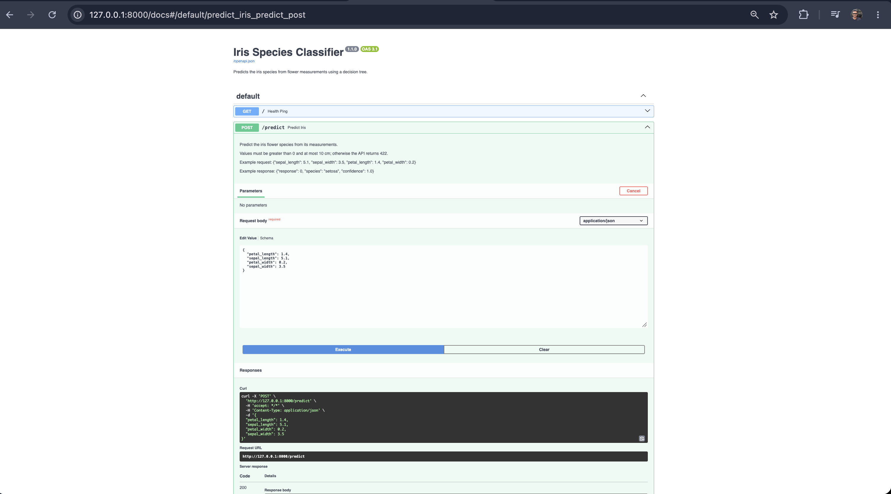
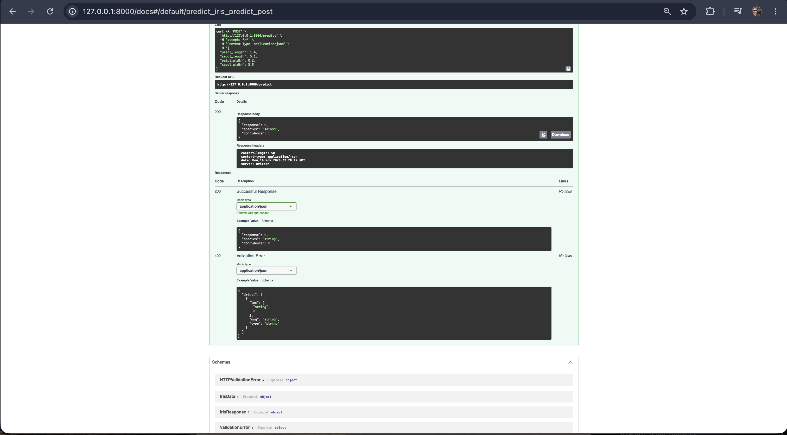
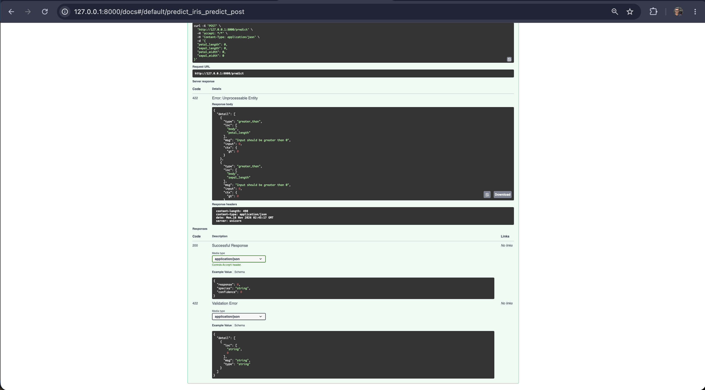

# FastAPI Lab 1: Serving an Iris Classifier as a Validated REST API

A decision tree trained on the Iris dataset, served as a REST API with FastAPI and uvicorn. You send four flower measurements as JSON and get back the predicted species, its class number and the model's confidence. Invalid measurements are rejected with a clear error.

This lab is based on FastAPI Lab 1 of the [raminmohammadi/MLOps](https://github.com/raminmohammadi/MLOps) course repository. I extended it with input validation, a richer response, startup model loading, path handling and training evaluation (see [What I changed](#what-i-changed-from-the-original-lab)).

## How it works

```
train.py  ──►  model/iris_model.pkl  ──►  main.py (FastAPI)  ◄──  client (browser /docs, curl)
                                          │
                                          ├── GET  /         health check
                                          └── POST /predict  species prediction
```

1. `train.py` loads the Iris dataset, splits it 70/30, trains a decision tree (`max_depth=3`), prints the test accuracy and saves the model.
2. `main.py` starts the API. The model is loaded once when the server starts.
3. Each request to `/predict` is checked by a Pydantic model before it reaches the model. Valid input gets a prediction; invalid input gets a `422` error.

## Project structure

```
FastAPI_Labs/
├── assets/                 # screenshots used in this README
├── model/
│   └── iris_model.pkl      # trained model (created by train.py)
├── src/
│   ├── __init__.py
│   ├── data.py             # loads and splits the Iris dataset
│   ├── train.py            # trains, evaluates and saves the model
│   ├── predict.py          # loads the model once, returns predictions
│   └── main.py             # FastAPI app and endpoints
├── README.md
└── requirements.txt
```

## API

### `GET /`

Health check.

```json
{"status": "healthy"}
```

### `POST /predict`

Request body (all values in cm, each greater than 0 and at most 10):

```json
{"sepal_length": 5.1, "sepal_width": 3.5, "petal_length": 1.4, "petal_width": 0.2}
```

Successful response:

```json
{"response": 0, "species": "setosa", "confidence": 1.0}
```

- `response`: the class number (0 = setosa, 1 = versicolor, 2 = virginica), kept for compatibility with the original API
- `species`: the predicted species name
- `confidence`: the model's probability for the predicted class

A borderline flower shows a lower confidence:

```json
{"response": 2, "species": "virginica", "confidence": 0.6667}
```

Invalid input, for example all zeros, returns `422 Unprocessable Entity` with one entry per invalid field:

```json
{"detail": [{"type": "greater_than", "loc": ["body", "petal_length"], "msg": "Input should be greater than 0", "input": 0, "ctx": {"gt": 0.0}}, ...]}
```

## Results

The decision tree reaches a test accuracy of **0.9556** on the 45-sample test split (trained on 105 samples).

## Screenshots

**Interactive docs** at `http://127.0.0.1:8000/docs`, showing the API title, description and the pre-filled example request:



**Successful prediction** returning the species and confidence:



**Validation error** when all measurements are 0:



## What I changed from the original lab

1. **Input validation.** The original only checked that the values were numbers, so a request with all zeros (a flower with no petals or sepals) still returned a prediction. Each measurement must now be greater than 0 and at most 10 cm, and anything else returns `422` with a message per field.
2. **Richer response.** The original returned only a class number. The response now also includes the species name and the model's confidence, keeping the original `response` field so existing clients still work.
3. **Model loaded once.** The original reloaded the model file from disk on every request. It is now loaded once when the server starts, and the server reports a clear error if the model file is missing.
4. **Robust paths.** The original used `../model/iris_model.pkl`, which only worked when run from `src/`. Paths are now built from the code's own location.
5. **Training evaluation.** The original created a test split but never used it. `train.py` now prints the test accuracy.
6. **Endpoint definitions.** The endpoints are plain functions instead of `async`, because the scikit-learn prediction is a blocking call. FastAPI runs plain functions in a thread pool, so a prediction doesn't hold up other requests.
7. **Documentation.** The API has a title, description and version, and the request fields have descriptions and example values, so `/docs` is easier to use.

## Setup and run

Requires Python 3.9 or newer.

1. Create and activate a virtual environment outside the repository, then install the requirements:

   ```bash
   python3 -m venv ~/venvs/fastapi_lab1_env
   source ~/venvs/fastapi_lab1_env/bin/activate
   pip install -r requirements.txt
   ```

2. Train the model:

   ```bash
   cd src
   python train.py
   ```

3. Start the API:

   ```bash
   uvicorn main:app --reload
   ```

4. Open `http://127.0.0.1:8000/docs`, expand `POST /predict`, click **Try it out**, then **Execute**. Or, from another terminal:

   ```bash
   curl -X POST http://127.0.0.1:8000/predict -H "Content-Type: application/json" \
     -d '{"sepal_length": 5.1, "sepal_width": 3.5, "petal_length": 1.4, "petal_width": 0.2}'
   ```

5. Stop the server with Ctrl+C.

## Notes

- The `--reload` flag restarts the server when code changes. It is meant for development, not production.
- The Iris dataset is small (150 samples), so the accuracy comes from a single 45-sample test split and is not a precise estimate.
- If `/docs` shows an old version of the API after a code change, hard-refresh the page (Cmd+Shift+R).