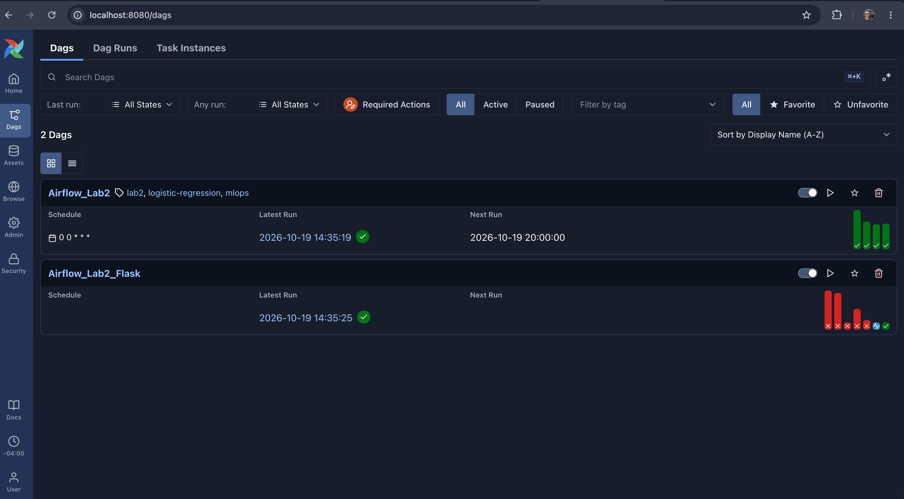
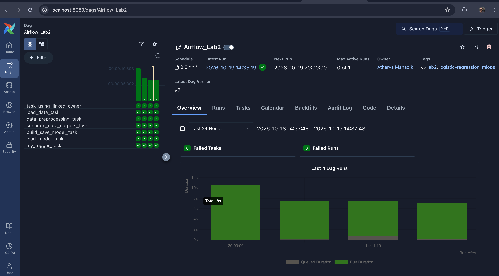
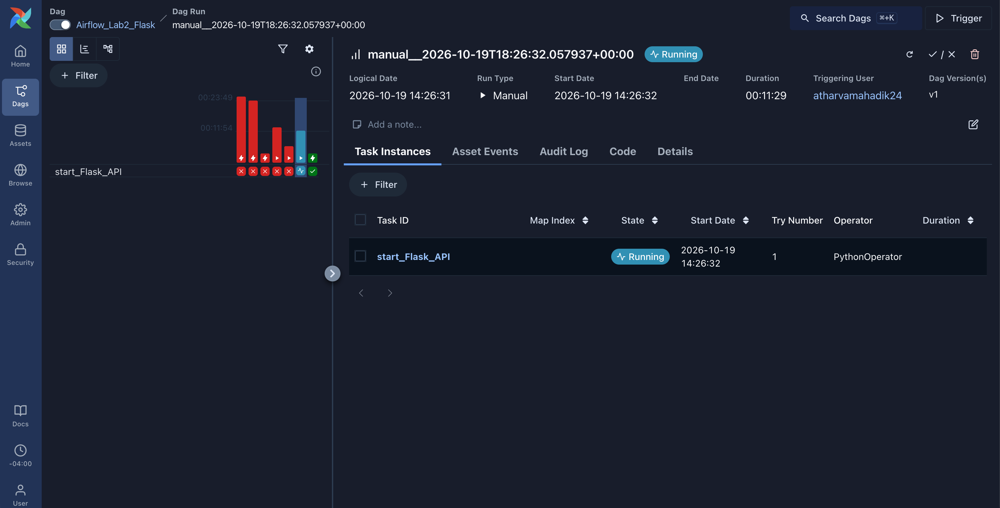

# Airflow Lab 2

An Apache Airflow 3 project that trains a logistic regression model to predict whether a user clicks an ad, and then starts a small Flask web dashboard that reports the status of the latest pipeline run together with the model's evaluation metrics.

This lab is based on Lab 2 of the [raminmohammadi/MLOps](https://github.com/raminmohammadi/MLOps) course repository. I rebuilt it to run on Airflow 3.3.1 and changed the authentication, preprocessing, metrics and dashboard (see [What I changed](#what-i-changed-from-the-original-lab)).

## How it works

The project has two DAGs.

**`Airflow_Lab2`** runs the machine learning pipeline once a day (or when triggered manually):

```
task_using_linked_owner
        |
   load_data_task            reads advertising.csv
        |
data_preprocessing_task      train/test split, scales numeric features
        |
separate_data_outputs_task   passes the preprocessed file path along
        |
build_save_model_task        trains logistic regression, saves model.sav
        |
   load_model_task           evaluates on the test set, writes metrics.json
        |
   my_trigger_task           triggers Airflow_Lab2_Flask
```

**`Airflow_Lab2_Flask`** has a single task, `start_Flask_API`, which starts a Flask server on port 5555. The server asks the Airflow REST API for the latest `Airflow_Lab2` run and shows a success page (with the model metrics) or a failure/in-progress page.

Tasks pass data to each other as file paths: each task writes its output to a pickle file in `working_data/` and returns the path, so the next task can load it.

## Project structure

```
Lab_2/
├── dags/
│   ├── main.py                    # Airflow_Lab2 DAG
│   ├── Flask_API.py               # Airflow_Lab2_Flask DAG + Flask app
│   ├── data/advertising.csv       # dataset
│   ├── src/model_development.py   # pipeline functions
│   └── templates/
│       ├── success.html           # dashboard: success + metrics
│       └── failure.html           # dashboard: failure / in progress
├── docker-compose.yaml            # Airflow 3.3.1 stack
├── images/                        # screenshots used in this README
├── model/                         # generated: model.sav, scaler.pkl, metrics.json
└── working_data/                  # generated: intermediate pickle files
```

## Results

Logistic regression on a 70/30 train/test split (300 test samples):

| Metric | Value |
| --- | --- |
| Accuracy | 0.97 |
| Precision | 0.9801 |
| Recall | 0.961 |
| F1 | 0.9705 |

## Screenshots

**DAG list** showing both DAGs, the tags, and the latest successful runs:



**Grid view of `Airflow_Lab2`:** all seven tasks succeed across several runs, with the owner and tags shown at the top:



**`Airflow_Lab2_Flask` run:** the `start_Flask_API` task stays in the running state because it hosts the dashboard server:



## What I changed from the original lab

1. **Fixed the dashboard authentication.** The original Flask code used HTTP basic auth against `/api/v2`. Airflow 3 rejects that with a `401`, so the dashboard always showed the failure page with `N/A` values. It now gets a JWT from `POST /auth/token` and sends it as a Bearer token, caching it and retrying once with a fresh token on a `401`.
2. **Handled the port 5555 conflict.** Starting Flask a second time used to crash with "address already in use". The task now checks the port first and exits cleanly if Flask is already running.
3. **Fixed the feature scaling.** The original applied both `MinMaxScaler` and `StandardScaler` to the same columns, including the binary `Male` column. I now apply a single `StandardScaler` to the four continuous columns only and pass `Male` through unchanged. The fitted scaler is saved to `model/scaler.pkl` so new data can be scaled the same way.
4. **Added full evaluation metrics.** Accuracy, precision, recall and F1 are computed on the test set, printed to the task log and saved to `model/metrics.json`.
5. **Extended the dashboard.** The success page has a new "Model Performance" card that reads `metrics.json`. The failure page now shows the run state and the explanatory note, such as "Model pipeline is still in progress...".
6. **Personalized the DAG.** New owner, tags and description, and the instructor's email address removed from the commented-out notification task.

## Setup and run

**Requirements:** Docker Desktop with enough memory for Airflow (about 4 GB or more).

1. Create a `.env` file in `Lab_2/` with these variables (never commit this file):

   ```
   AIRFLOW_UID=50000
   FERNET_KEY=<generate one, see below>
   _AIRFLOW_WWW_USER_USERNAME=<your username>
   _AIRFLOW_WWW_USER_PASSWORD=<your password>
   ```

   Generate a Fernet key with:

   ```bash
   python3 -c "from cryptography.fernet import Fernet; print(Fernet.generate_key().decode())"
   ```

2. The `docker-compose.yaml` is the official Airflow 3.3.1 file with these edits:
   - `_PIP_ADDITIONAL_REQUIREMENTS` set to `pandas scikit-learn flask requests`
   - `LOAD_EXAMPLES` set to `false`
   - `AIRFLOW_USERNAME` and `AIRFLOW_PASSWORD` mapped from the `.env` login
   - `./working_data` and `./model` mounted into the containers at `/opt/airflow/...`
   - port `5555` published on `airflow-worker`

3. Start the stack:

   ```bash
   docker compose up airflow-init
   docker compose up -d
   ```

4. Open the Airflow UI at `http://localhost:8080`, log in, and trigger `Airflow_Lab2`.
5. When the run finishes, open the dashboard at `http://localhost:5555`.
6. Stop everything with `docker compose down`.

## Troubleshooting

- **Dashboard shows "site can't be reached":** Flask only runs while the `start_Flask_API` task is running. Trigger `Airflow_Lab2_Flask` (or run `Airflow_Lab2`, which triggers it).
- **Changed `Flask_API.py` or a template and nothing changed on the page:** the running Flask process keeps the code it started with. Run `docker compose restart airflow-worker`, wait until the worker is healthy, then trigger `Airflow_Lab2_Flask` again.
- **Port 8080 already in use:** another Airflow stack (for example Lab 1) is still running. Stop it first.
- **Plain reruns of `Airflow_Lab2`** do not need a restart. The dashboard reads the newest run and `metrics.json` every time the page loads.

## Notes and limitations

- The email notification task is left disabled. Sending email needs an SMTP connection configured in Airflow, which I did not set up.
- The pipeline trains and evaluates on a single fixed split, so the metrics describe one run rather than a cross-validated estimate.
- The dashboard is for local use only. It has no authentication of its own and is not meant to be exposed to a network.